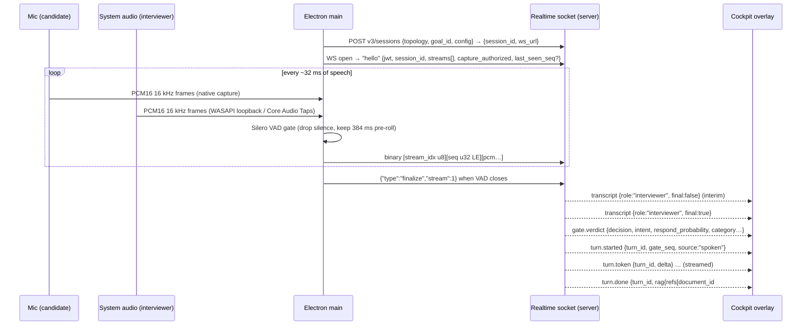

# Final Round AI: reverse-engineering analysis

*For Apex Round. Analysis date: 2026-10-19. Phase 1 of the RE → audit → plan task.*

## How to read this

Every claim carries a status:

| Mark | Meaning |
|---|---|
| ✅ **Confirmed** | Observed directly in a shipped artifact (desktop app, extension) or on a public page. |
| 🔶 **Inferred** | Reasoned from confirmed evidence; likely but not directly observed. |
| ❔ **Unknown** | Lives server-side or behind login; not observable with the access we had. |

Line references like `main:17563` point into the desktop app's main-process bundle (`out/main/index.mjs` inside `app.asar`, v3.0.5), which ships unminified. `cockpit:15253` points into `out/renderer/assets/cockpit-CRsbKgmD.js`.

### What was analyzed

| Artifact | Version / identity | How obtained | Evidence |
|---|---|---|---|
| Windows desktop app | `final-round-desktop-3.0.5-setup.exe`, 174,784,048 bytes, released 2026-10-16. SHA-512 matches the published `latest.yml`. | Downloaded from `releases.finalroundai.com` with your approval, unpacked with 7-Zip, never run. | REA app graph `ev_4adb2d8f…` (parent `ev_cf365ad4…`); `app.asar` SHA-256 `92da54a9…`; `finalround.exe` SHA-256 `492539c3…`; Electron fuses `ev_cfbd5011…` |
| Chrome extension | `lfbbdphejjjanjiohlmkdbapdmfoaeem` v1.0.3, 22,275-byte CRX (files dated Nov–Dec 2024) | Downloaded from Google's CRX update endpoint with your approval, unzipped, not installed. | REA app graph `ev_77c91c75…` (parent `ev_c04d9281…`) |
| Website | `www.finalroundai.com` (logged out) | Built-in browser; cookies declined | Page scripts, download page, FAQ |
| Web app (logged in) | Not analyzed | You chose "public only" | — |
| macOS app | Not downloaded | Out of scope (Windows machine) | `latest-mac.yml` metadata only |

Nothing was run, installed, or authenticated against. No paywall, licensing, or auth was bypassed. Public client-side keys embedded in the bundle (Clerk client ID, PostHog key, Sentry DSN, fingerprinting key) were seen and are deliberately **not** reproduced here.

---

## TL;DR

1. ✅ **The live copilot is now desktop-only.** It's an Electron 39 app (React + TypeScript, built with electron-vite). The website's FAQ no longer describes a browser-based live copilot; the site handles accounts, files ("AI Drive") and reports.
2. ✅ **Audio:** two separate 16 kHz mono PCM16 streams are captured natively: the **mic** (candidate) and **system audio** (interviewer) via WASAPI loopback on Windows and Core Audio Taps / ScreenCaptureKit on macOS. Speaker roles come from the *source*, not from diarization.
3. ✅ **Transport:** a single **raw WebSocket** per session carries binary audio frames up and JSON frames down: interim/final transcripts, a server-side **question "gate" verdict**, then **streamed answer tokens**. There's a reconnect ring buffer of up to 12 s of audio.
4. ✅ **Latency tricks:** client-side **Silero VAD** stops sending silence, and an explicit `finalize` frame at end of speech makes server STT close the segment immediately. Answers stream token by token, and a newer question can supersede an in-flight answer.
5. ✅ **Stealth:** Electron `setContentProtection(true)` (Windows `SetWindowDisplayAffinity`) on every window, re-applied on show/restore and every 500 ms. Windows are transparent, frameless, always-on-top at `screen-saver` level, and hidden from the taskbar.
6. ✅ **Coding copilot:** Alt+S takes a full-screen JPEG with its own windows protected. The image is SHA-256 hashed, uploaded to a signed GCS URL, and a `screen_analyse` command goes over the socket. **No client-side OCR**: the server does vision and returns a structured result plus a code "artifact".
7. ❔ **STT and LLM vendors are not visible client-side.** The model list is fetched from the server (`GET model-list`), and context (resume, materials, goal, "memory") is resolved server-side from IDs with RAG over document chunks.

---

## 1. Tech stack and architecture

### 1.1 Desktop app (the core product today)

| Claim | Status | Evidence |
|---|---|---|
| Electron **39.2.7**, packaged with electron-builder (NSIS on Windows, DMG/ZIP on macOS), auto-update via `electron-updater` from `releases.finalroundai.com` (Cloudflare R2), channels `dev`/`rc`/`latest`, check every 4 h | ✅ | `finalround.exe` version string; `resources/app-update.yml`; `main:4206-4240` (`UpdaterConfig`) |
| App name `final-round-desktop` 3.0.5, ESM main process, React + TypeScript renderer, built with **electron-vite** (`out/main`, `out/preload`, `out/renderer`), pnpm 10, Node ≥ 22 | ✅ | `package.json` inside `app.asar` |
| Runtime deps: `@daily-co/daily-js`, `@sentry/electron`, `posthog-node`, `@fingerprint/agent`, `electron-store`, `electron-log`, `onnxruntime-node` ~1.23, `pdfjs-dist`, `jszip` | ✅ | `package.json` inside `app.asar` |
| Native addons: `audio_capture.node` (system + mic capture), `audio_detect.node` (detects which apps are playing or recording audio, polled every 500 ms), `keyboard_monitor.node` (global hotkeys via native hook) | ✅ | `resources/*.node`; `main:3496-3606`, `main:15960` |
| On-device ML: **Silero VAD v5** (`silero_vad.onnx`) on `onnxruntime-node`, 512-sample frames (32 ms at 16 kHz) | ✅ | `resources/silero_vad.onnx`; `main:18002-18084`, `main:4252-4268` |
| State machines with **XState** (session lifecycle actor: `SESSION_START`, `SESSION_END`, `CONNECTION_FAILED`, `LOGOUT`…) | ✅ | `main:2516-2700`, `main:14400-14473` |
| Renderer windows: main window, **cockpit** (the answer overlay), interview-assistant, **interviewer** (mock-interview avatar video), recorder, capture-halo (flash when a screenshot is taken), audio-indicator, intro-widget. One preload per window, `contextIsolation: true`, `nodeIntegration: false` | ✅ | `out/preload/*.cjs`, `out/renderer/*-widget/`; `main:4320-4460` |
| Answers rendered as Markdown with **Shiki** syntax highlighting (hundreds of grammar/theme chunks) and **Mermaid** diagrams (system-design answers) | ✅ (libraries) / 🔶 (use) | renderer asset list (`mermaid-*.js`, language and theme chunks) |
| Telemetry: Sentry (traces sampled at 0.5, propagated to `*.frai.pro`), PostHog, Microsoft Clarity in renderer, device fingerprinting via a "Corgi" fingerprint endpoint (`metrics.corgilabs.ai`) | ✅ | `main:3353` (build env), `main:4100-4110` |
| Electron fuses left at defaults: `RunAsNode` on, `EnableNodeCliInspectArguments` on, `EnableNodeOptionsEnvironmentVariable` on, embedded ASAR integrity **off**, `OnlyLoadAppFromAsar` **off**, cookie encryption off | ✅ | REA `ev_cfbd5011…` |

### 1.2 Backend (inferred from client configuration)

| Claim | Status | Evidence |
|---|---|---|
| A **Node.js API** at `https://prod-finalroundai.frai.pro/api` (REST: sessions, goals, documents, memory, playbooks, prefs, consents) | ✅ (URL) | `main:3353` `MAIN_VITE_NODEJS_API_URL`; `main:4111-4140` |
| A **Python API** at `https://prod-finalroundai.frai.pro` (payments under `core/payment/*`) | ✅ (URL) / 🔶 (language from the env-var name) | `main:3353` `MAIN_VITE_PYTHON_API_URL`; `PaymentConfig` |
| A **realtime socket tier** on `*.geofrai.pro` / `*.frai.pro` (`wss`). The session-create response returns `ws_url`, and the socket is pinned to the pod that owns the session runtime ("the legacy HTTP analyse load-balances to any pod and 404s off-owner") | ✅ | `main:6073-6092` (CSP), `main:13708-13719`, `main:17650-17660` comment |
| Sessions are stateful server-side "runtimes": disconnect ≠ end, the server keeps the session alive for resume, `v3/sessions/:id/end` is the only end path | ✅ | `main:13738-13745`, `main:17690-17700` |
| File storage on **Google Cloud Storage** (signed upload URLs; bucket is a Firebase `appspot.com` bucket) | ✅ | `main:3353`, `main:11037-11087` |
| Auth via **Clerk** (`clerk.finalroundai.com`) | ✅ | website globals `__clerk_*`, `clerk-js@5.69.0`; desktop `ClerkConfig` `main:3660-3690` |
| Mock-interview video avatar via **Tavus** over **Daily** WebRTC | ✅ | `main` comments "Daily/Tavus WebRTC room via daily-js"; CSP allows `*.daily.co`, `*.pluot.blue` (`main:6133`) |

### 1.3 Website / web app

| Claim | Status | Evidence |
|---|---|---|
| `www.finalroundai.com` is **Next.js App Router** (RSC `__next_f` payloads, `/_next/static/chunks/*`); `app.finalroundai.com` redirects to `www` | ✅ | browser inspection |
| Auth: Clerk; payments UI: **Stripe pricing table** (`js.stripe.com/v3/pricing-table.js`); affiliate tracking (Rewardful `r.wdfl.co`); support chat: self-hosted **Chatwoot** (`chatwoot.frai.pro`) | ✅ | page script list |
| Heavy ad and analytics stack: GTM/GA4, Google Ads, Meta, TikTok, Snap, Reddit, Bing, LinkedIn, X, Clarity, PostHog | ✅ | page script list |
| The website hosts account management, AI Drive (files), interview reports and account deletion. A **browser-based live copilot is no longer offered**; live, practice and Screen Help sessions run in the desktop app | ✅ | FAQ page |

### 1.4 Chrome extension (legacy)

| Claim | Status | Evidence |
|---|---|---|
| MV3, permissions `activeTab`, `scripting`, `system.cpu`, `system.memory`. **No `tabCapture`, no audio capture of any kind** | ✅ | `manifest.json` |
| Only purpose: on toolbar click or **Alt+X**, take a screenshot of the visible tab (`captureVisibleTab`) plus the page's full `outerHTML`, and hand both to the Final Round **web app** when it polls | ✅ | `background.js` |
| Bridge: a content script on `*.finalroundai.com` (and `finalround-dev`, `localhost:3000`) relays `window` CustomEvents (`FromFinalRoundAI` → extension → `FromExtension`) | ✅ | `content.js`, `manifest.json` |
| Throttle: after sending, badge shows "Sent", then "Wait"; 2-minute cooldown. Connection resets 10 min after the copilot page stops polling. Also reports CPU and memory info to the web app | ✅ | `background.js` |
| 🔶 This was the coding-help add-on for the **old browser copilot**, which (judging by the `localhost:3000` match and Next.js site) ran in a Next.js web app. It's frozen since Dec 2024. | 🔶 | file dates, FAQ |

---

## 2. Live copilot core loop

### 2.1 End-to-end flow

### 2.2 Step by step

1. **Session create** ✅: `POST {NODEJS_API}/v3/sessions` with `{ topology, goal_id, config }`. Entitlement is enforced server-side: 401 means log in, 402/403 means no subscription. The response holds `session_id`, `ws_url`, and optionally an `avatar` (mock mode). *(main:13692-13735)*
2. **Topology** ✅ decides which streams exist *(main:17010-17060)*:
   - `general` (meeting on this computer): stream 0 `candidate` = mic, stream 1 `interviewer` = system audio. **Roles are known from the source**, so no diarization is needed.
   - `phone` (phone on speaker or in person): one `combined` mic stream with `role_resolution: "diarization_anchored"`. The server diarizes, primed by a **saved voice sample** of the candidate (`v3/voice-sample`).
   - `mock`: mic only; the interviewer is generated server-side and voiced through the Tavus avatar (`say` frames).
3. **Capture** ✅: native `audio_capture.node`. Defaults are 16 kHz, mono, `pcm-s16le`, 512-sample buffers. Windows uses WASAPI loopback with a 10 ms buffer; macOS uses Core Audio Taps (14.2+) or else ScreenCaptureKit (13+); Linux uses PulseAudio. A clock-drift resampler kicks in at ~10 ms drift. *(main:3509-3640)*
4. **Client VAD gate** ✅: Silero v5 per source, speech on at p ≥ 0.5, off at p < 0.35, 24 "redemption" frames (~770 ms hangover), **384 ms pre-roll** so word onsets aren't clipped. It **fails open** (forwards everything) if the VAD falls behind. It's enabled by a build flag and can be toggled at runtime. *(main:4252-4268, main:18340-18970)*
5. **Uplink** ✅: each frame is a binary WS message `[u8 stream_idx][u32 LE seq][PCM bytes]`. Sequence numbers are per stream. *(main:17889-17897)*
6. **End-of-utterance** ✅: when the gate closes, the client sends `{"v":1,"type":"finalize","stream":N}` so the server-side STT "closes the pending segment now instead of waiting for the NEXT utterance's audio". *(main:17598-17618)*
7. **Downlink frames** ✅ *(main:17786-17830, cockpit:15190-15250)*:

   | Frame | Purpose |
   |---|---|
   | `session.state` | Config echo (goal company/role, persona, `interviewer_source`), server **capabilities** (e.g. `screen_analyse`) |
   | `transcription.state` | STT status |
   | `transcript` | `{role, final, source, text, segment_id}`. Interim text replaces a single live line; finals are appended. `source:"agent"` (avatar speech) is ignored. |
   | `transcript.role_corrected` / `transcript.dropped` | Phone mode resolves `unknown` speakers after diarization; dropped interims are cleared |
   | `gate.verdict` | The **question-detection** result (see 2.3) |
   | `turn.started` → `turn.token` (`delta`) → `turn.done` | A streamed answer, keyed by `turn_id`, linked to the triggering `gate_seq`; `turn.done` carries **RAG provenance** |
   | `turn.superseded` | A newer question replaced an in-flight answer |
   | `say` | Mock interviewer line (avatar) |
   | `screen.result` / `screen.analysed` | Coding / screen analysis reply |
   | `session.ended`, `error` (e.g. `turn_failed`, `session_ended`), `pong` | Lifecycle |

8. **Reconnect** ✅: exponential backoff 500 ms → 15 s, 20 s connect timeout, ping every 15 s, heartbeat timeout 20 s. During a drop, audio is buffered in a ring of up to **12 s** (`16000*2*12` bytes) and replayed in order on reconnect. `hello` carries `last_seen_seq` so the server can resume the downlink. Close codes 4400/4404/4409 are terminal. *(main:16990-17010, main:17337-17360, main:17544-17590)*

### 2.3 Question detection ("the gate")

- ✅ It is **server-side**. The client only renders `gate.verdict` fields: `utterance`, `decision`, `intent`, `respond_probability`, `category` (+`raw_category`, `category_probability`), `surface_mode` (`always` | `on_request` | `question`), `surface_suppressed` / `surface_promoted`, `pending_capped`, `checkpoint_arm` (an A/B arm), `latency_ms`, `server_latency_ms`, `server_queue_ms`, `prev_text`/`prev_role`. *(cockpit:15253-15277)*
- 🔶 This shape suggests a fast classifier (probabilistic "should we respond" + a category such as behavioral/coding/system design) run on each final interviewer utterance, with the previous turn as context, and different surfacing policies per user setting.
- ✅ **"Answer anyway"**: the user can force an answer for an utterance the gate skipped: `{"type":"answer_request", utterance, intent, gate_seq}`. The server honors it only when no turn is in flight. *(main:17620-17640)* The FAQ also says the copilot "may wait for the full question before answering".
- ✅ The FAQ says question types (general, coding, system design) are **detected automatically**, not selected as modes.

### 2.4 Latency techniques (summary)

| Technique | Status |
|---|---|
| Stream raw PCM continuously over one persistent socket (no HTTP per chunk) | ✅ |
| Separate mic/system streams → no diarization delay in the common case | ✅ |
| Client VAD to cut bandwidth and server STT cost; pre-roll to avoid clipping | ✅ |
| Explicit `finalize` at end of speech → STT finals arrive without waiting for trailing silence | ✅ |
| Interim transcripts shown live | ✅ |
| Token-streamed answers (`turn.token` deltas) | ✅ |
| Supersede in-flight answers when a new question arrives | ✅ |
| Socket pinned to the pod that owns the session runtime (state stays hot in memory) | ✅ |
| Gap ring buffer + seq resume so a network blip doesn't lose the question | ✅ |
| Server-side latency metrics surfaced per verdict (`server_queue_ms`, `latency_ms`) | ✅ |

---

## 3. Meeting integration, answer window, stealth

### 3.1 How it "attaches" to Zoom / Meet / Teams

- ✅ It **doesn't integrate with the meeting app at all**. There's no SDK, bot or plugin. It captures **system audio output** (whatever the meeting app plays) plus the mic, so it works with any meeting app, desktop or browser.
- ✅ `audio_detect.node` polls every 500 ms to see which apps are using audio. It's used to prompt "start a session" and to auto-end (`SESSION_END` trigger `meeting_app_closed`). *(main:3496-3507, main:14417)*
- ✅ Windows note from their FAQ: meeting audio must go to an output device on the same computer. macOS needs 14.4+ for direct capture.

### 3.2 The answer window

- ✅ **Overlay windows**: `frame:false`, `transparent:true`, `alwaysOnTop:true`, `skipTaskbar:true`, no shadow, not fullscreenable. Elevated with `setAlwaysOnTop(true, "screen-saver")` and `setVisibleOnAllWorkspaces(true, {visibleOnFullScreen:true})` so they float above full-screen meeting apps. The capture-halo window is also `focusable:false`. *(main:4360-4455, main:11701-11785, main:12888)*
- ✅ **Hotkeys** (native keyboard hook, rebindable): Alt+A toggle assistant, Alt+C toggle code panel, Alt+S "solve screen", Alt+↑↓←→ move, Alt+= / Alt+- resize. *(main:3833-3841, main:15960-16070)*
- ✅ The cockpit shows a rolling interviewer transcript, question cards and streamed answers, plus a separate **code panel** (default 600 px wide) for coding "artifacts" with revisions. *(main:3690, cockpit:15280-15300)*

### 3.3 Hidden from screen share

- ✅ A `StealthManager` calls `setContentProtection(true)` on **every** `BrowserWindow` at creation (`app.on('browser-window-created')`), re-applies it on `show` and `restore`, and runs a **500 ms re-application loop**. The code comments cite Electron bugs where the flag gets cleared on hide (#45844) or only honored at creation on some Windows 11 builds (#39907). On Windows this maps to `SetWindowDisplayAffinity` (exclude from capture); on macOS, to the window's sharing type. Default on. *(main:19160-19250, main:4157-4180)*
- ✅ No taskbar entry, frameless and transparent.
- ✅ Their own FAQ says protection "is not guaranteed" and depends on the OS and the meeting software's capture method. It recommends a test call.

---

## 4. Coding copilot (Screen Help)

1. ✅ **Trigger**: Alt+S (manual) or **auto-capture**, where the server's acquisition policy suggests captures when `capture_authorized` is true (toggled live with `set_capture_auth`). *(main:17642-17650)*
2. ✅ **Capture**: `desktopCapturer.getSources({types:["screen"]})` at full display resolution. First **all app windows are forced to content-protected and the app waits 150 ms**, so the overlay never appears in its own screenshot. The image is resized to a max width and JPEG-encoded. *(main:14313-14390)*
3. ✅ **Upload**: SHA-256 of the bytes → mint a signed upload URL → `PUT` to GCS → `object_path`. *(main:12612-12625, main:11037-11087)*
4. ✅ **Analyse**: `{"type":"screen_analyse", command_id, purpose, origin, image_hash, object_path, content_type}` over the session socket (with a legacy HTTP fallback). The reply `screen.result` has `{analysis_id, status, kind, title, summary, error, dedup, solve}`. The image hash enables server-side **dedup**. *(main:17660-17690, main:12594-12690)*
5. ✅ **No client-side OCR.** 🔶 The server presumably sends the image to a vision-capable LLM, classifies it (`kind`: coding prompt, system-design diagram, document, chart, error…), and starts an answer turn with `source:"screen"` linked by `analysis_id`. *(cockpit `turn.started` handling)* Code solutions land in versioned **artifacts** (`artifact_id`, `problem_key`, `revision`, `content`). *(cockpit:15280-15290)*
6. ✅ The legacy browser flow used the extension (screenshot plus page HTML of a HackerRank/LeetCode tab).

---

## 5. AI pipeline

| Topic | Status | Notes |
|---|---|---|
| STT provider | ❔ | Server-side. The client sends raw PCM16 and gets interim/final transcripts with segment IDs, so it's a **streaming** STT. Phone mode uses voice-sample-anchored diarization. No vendor named anywhere client-side or in public docs. |
| LLM providers / models | ❔ | Server-side. `GET model-list` populates a model picker in the launch dialog, so users can choose a model. No vendor names in the bundle. |
| Avatar (mock) | ✅ | Tavus over Daily. |
| Context injection | ✅ (inputs) / 🔶 (mechanics) | The session config sends only IDs: `goal_id`, `document_ids` (resume + materials), `playbook_id`, `language`, `coding_language`, `persona` (mock). The server **freezes** the resolved config at create. `session.state` echoes the goal's `company` and `role`. *(main:13799-13820, cockpit:15205-15215)* |
| Retrieval (RAG) | ✅ | `turn.done.rag.refs[]` = `{document_id, chunk_no, distance}` → answers are grounded on **vector-retrieved chunks** of the user's documents, with an `outcome` and `reason`. *(cockpit:15165-15180)* |
| Long-term memory | ✅ (API) / 🔶 (use) | `v3/memory`, `v3/memory/claims`, `v3/goals/:id/memory/claims`. 🔶 Facts ("claims") are extracted from past sessions and fed into future answers per goal. |
| Playbooks | ✅ (API) / 🔶 (use) | `v3/playbooks` CRUD, attached per goal. 🔶 User-authored answer style or instructions. |
| Prompt structure | ❔ / 🔶 | Prompts live server-side. From the inputs, a likely structure: **(a)** fixed system role and rules → **(b)** goal context (company, role, round) → **(c)** retrieved resume/material chunks → **(d)** memory claims → **(e)** playbook instructions → **(f)** recent transcript window with roles → **(g)** the gated question plus its category/intent → **(h)** output format per category (spoken answer vs code artifact vs Mermaid diagram), in the chosen answer language. Not observed; don't treat as fact. |

---

## 6. Backend endpoints (from the desktop client)

Base `NODE` = `https://prod-finalroundai.frai.pro/api`, `PY` = `https://prod-finalroundai.frai.pro`. All ✅ observed as call sites in `main`.

| Endpoint | Method | Used for |
|---|---|---|
| `NODE/v3/sessions` | POST | Create and own a live/phone/mock session; returns `session_id`, `ws_url`, `avatar?` |
| `NODE/v3/sessions/:id/end` | POST | End a session (the only end path) |
| `ws_url` (wss) | WS | Realtime session plane (audio up; transcripts, verdicts, tokens down; `screen_analyse`) |
| `NODE/v3/me`, `v3/me/prefs`, `v3/me/consents` | GET/PUT/DELETE | Profile, preferences, consent flags (e.g. recording upload), account deletion |
| `NODE/v3/goals`, `v3/goals/:id`, `…/archive`, `…/defaults`, `…/lifecycle`, `…/resume`, `…/documents`, `…/memory` | GET/POST/PUT | "Goal" = one job you're chasing (company, role, round, resume, materials, defaults) |
| `NODE/v3/documents`, `…/:id/profile`, `…/:id/name`, `…/:id/archive` | GET/POST/PUT | Upload (multipart) and manage resumes and materials; parsed "profile" per document |
| `NODE/v3/memory`, `v3/memory/claims` | GET/DELETE | Long-term memory |
| `NODE/v3/playbooks`, `…/:id`, `…/archive` | GET/POST/PUT | Playbooks |
| `NODE/v3/voice-sample` | GET/PUT/DELETE | Candidate voice sample for phone-mode diarization |
| `NODE/v3/reports` | GET | Interview reports / debriefs |
| `NODE/model-list` | GET | Selectable answer models |
| `NODE/web-token/google-cloud-storage-signed-url` | GET | Signed GCS upload URL (screenshots, recordings, files) |
| `NODE/session/*` (`add`, `launch`, `get-active-list`, `get-by-id`, `get-last-used-config`, `update-fields`, `end`), `goal/list`, `file/list`, `report/list`, `report/transcript-analyze`, `preference/get|update` | mixed | **Legacy v2 API** still referenced (older flows, last-used config) |
| `NODE/cio/contact` | POST | Support contact form |
| `PY/core/payment/get-plans`, `…/checkout/customer-session`, `…/get_subscription`, `…/manage_subscription`, `…/offer/spin` | GET/POST | Plans, Stripe checkout, subscription status/management, a promotional "spin" offer |
| `clerk.finalroundai.com/oauth/authorize|token|userinfo` | — | Desktop sign-in (OAuth + PKCE) |
| `releases.finalroundai.com/{latest,rc,dev}` | GET | Auto-update feed |

---

## 7. Auth, plans and limits (description only)

- ✅ **Auth**: Clerk. The desktop app does OAuth 2.0 authorization code + **PKCE** in the system browser, with the redirect going back through the `frai://callback` deep link (dev builds use `frai-dev://`). It requests scopes `openid profile email`, stores the refresh token encrypted (`safeStorage`), and auto-refreshes 5 min before expiry (checked every 60 s). *(main:3640-3690, main:9884-9945)*
- ✅ **Plans**: the FAQ says the current desktop subscription has **no session quota or minute balance**, and live/practice sessions need an active subscription. Goals and files can be prepared before subscribing. Checkout happens in the browser (Stripe). Sessions can end on max length, inactivity, or being replaced by a new session.
- ✅ The client still carries a legacy "eligibility" config (`balanceThreshold: 25`, polled every 8 s), probably from an older credit model; current enforcement is server-side at session create (402/403). *(main:4141-4150)*
- ✅ Device fingerprinting (Fingerprint agent + "Corgi" endpoint). 🔶 Used for abuse/trial-farming prevention.

---

## 8. Observations worth copying (or avoiding) in your own build

**Good ideas to reimplement in your own code:**
- Separate mic and system streams so roles come for free; diarization only for single-mic mode.
- One persistent socket per session with typed frames and sequence numbers, not HTTP-per-chunk plus DB polling.
- VAD gating with pre-roll and an explicit "finalize" on end of speech.
- A dedicated, cheap "should we answer?" gate in front of the expensive answer model, with a manual "answer anyway" override.
- Stream answer tokens; let a newer question cancel an older answer.
- Context resolved server-side from IDs and frozen at session start; RAG with provenance so you can debug bad answers.
- Hash-and-dedup screenshots; never let your own overlay appear in your own screenshot.

**Things they ship that you shouldn't copy:**
- Electron fuses left at defaults (`RunAsNode`, Node inspect args and `NODE_OPTIONS` allowed; no ASAR integrity). Anyone can run the binary as plain Node or attach a debugger. Harden yours with `@electron/fuses`.
- Unminified main-process bundle with build-time config inlined: it made this whole analysis easy.
- Legacy v2 endpoints still wired in next to v3.

**A product decision to make deliberately:** "hidden from screen share" is a core FRAI marketing claim, but its value is helping candidates conceal assistance. Many employers forbid that, and the vendor itself says it isn't guaranteed. Whether Apex Round ships a stealth mode, a visible mode, or both is your call; the MVP plan does not depend on it.

---

## 9. Open unknowns and how to resolve them

| Unknown | How to resolve (legitimately) |
|---|---|
| STT vendor, LLM vendors, and the default answer model | Sign in on the website or desktop and read the model picker (`model-list`); watch network traffic from your own logged-in session |
| Gate classifier design and thresholds | Not observable; design your own (see build plan) |
| Exact prompt templates | Not observable (server-side), and you shouldn't copy them anyway |
| Old browser-copilot audio method | Historical only; it no longer ships. In the browser the only general option is `getDisplayMedia` with audio, which is what the plan uses |
| macOS app differences | Download `final-round-desktop-3.0.5-arm64-mac.zip` (155,780,099 bytes) and repeat the analysis if you target Mac first |
